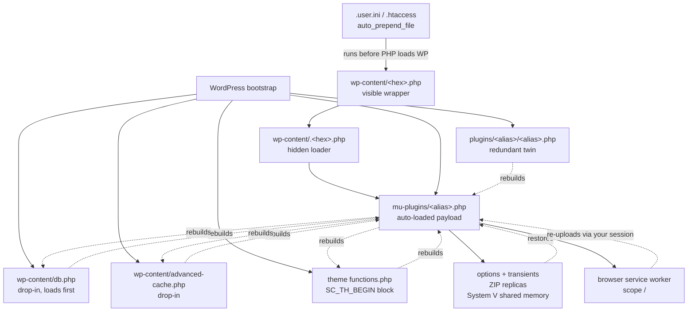
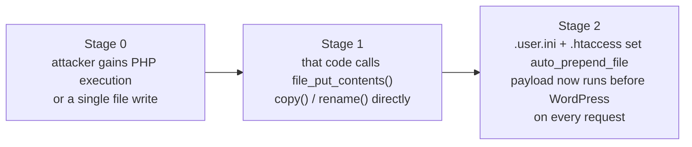

# SC 4.x - self-healing WordPress malware: detection toolkit

Tools and a written procedure for the WordPress infection that rebuilds itself
seconds after you delete it. It appeared as **SC 4.0.3** in late August 2026 and
had evolved into **`SCV:4.3.24`** two weeks later; both are covered here. It is
seen in the wild under throwaway plugin names - *Trace Scanner Lite*,
*trace-store-x*, *Elite Module Cue* - and the alias changes per campaign, so
none of the detection below depends on one.

The repo is in two halves, and the split is deliberate. **Everything that finds
this thing is read-only** - scanner, calculator, tripwire, browser neutralizer.
**Everything that removes it is destructive, dry-run by default, and refuses to
be run out of order**, because order is the single thing that decides whether a
cleanup works. If you are here in a hurry: run the scanner first, read the
eradication order, and only then touch `sc403-killchain.sh`.

> **The full teardown of 4.3.24** - obfuscation, the derived-name algorithms,
> the nine persistence nodes, the browser channel and the kill chain, with the
> decoded source side by side with the original - is written up in the companion
> article, *Anatomy of a Self-Healing WordPress Implant*.
>
> **Running a hosting platform?** Go to
> **[HOSTING-PROVIDERS.md](HOSTING-PROVIDERS.md)** instead - fleet triage, the
> account-level rule, the log sweep only you can run, and what to tell customers.
> Two of the three things that stop this malware are only reachable with root.
>
> Researching *why* this works rather than how to clean it? See
> **[TECHNICAL.md](TECHNICAL.md)** - the root cause, the trust-boundary analysis,
> and why only kernel-level controls bind.

---

## Read this before you touch anything

If you think a site you run is infected right now:

1. **Do not delete files one at a time on a live site.** The implant keeps nine
   redundant copies of itself. Removing the one you can see, while the others are
   still executing, is what makes it look unkillable - the survivors rebuild it on
   the next request.
2. **Do not log in to `/wp-admin` from your normal browser.** The implant registers
   a service worker that intercepts your login POST and can re-upload the plugin
   using your own authenticated session. Every admin login hands it fresh material.
3. **Snapshot first.** Filesystem *and* database, before you change anything. Files
   are timestomped, so your own snapshot is more trustworthy evidence than any
   "Last Modified" column.

If the site belongs to a client or an institution, treat it as an incident, not a
cleanup task.

---

## What it is

A WordPress implant that steals administrator passwords in plaintext, creates a
hidden administrator, forges valid auth cookies for *every* existing administrator
with a 14-day expiry, injects content, takes remote PHP and JavaScript from a C2,
and spreads to every other WordPress install writable by the same OS user.

It resolves its C2 through **Ethereum smart contracts** - an `eth_call` with
selector `0x3bc5de30` against embedded contract addresses returns XOR-encrypted C2
URLs. There is no domain to take down.

## Why deleting it doesn't work

The infection is not a chain, it's a **mesh**. Every node can rebuild the others:



Three of those nodes are outside the filesystem entirely - the database, PHP
process memory, and *your browser*. A cleanup that only touches files cannot win.

`db.php` and `advanced-cache.php` deserve special attention: WordPress loads them
**before** must-use plugins, which is why no plugin-based security tool can reliably
defend against this.

---

## What changed between 4.0.3 and 4.3.24

Two weeks of development, and every change is aimed at the defender rather than
at the victim:

| | 4.0.3 (August) | 4.3.24 (September) |
|---|---|---|
| File hashes | Stable. Eight known SHA-256 values. | **Dead.** Every write is padded to a random size between 5.5 and 7.0 MB with `/*<random hex>*/` comments. No two installations share a hash. |
| Derived names | Filenames only. | **Three families**: filenames, HTTP endpoints, and database option keys. |
| Database | `sc_*` options and transients. | `sc_*` **plus fourteen options whose names are `md5(ABSPATH . 93819 . slot)[0:12]`** - they do not start with `sc_`, and prefix-based cleanups both miss them and destroy the evidence in them. |
| Browser | Service worker stealing login POSTs. | Same worker, now reachable at a **derived `?p=<8 digits>` URL** that also serves it a fresh payload. |
| Fighting back | Rebuilds immediately. | Counts your deletions, backs off after three per drop-in per day, and **stops fighting until midnight UTC** - so a failed cleanup looks like a successful one. |

The practical consequence: **stop hunting hashes and start computing names.**

---

## Names, not hashes

This is the part worth knowing even if you never run anything in this repo.

Everything the implant creates is named with plain `md5()` over the site's own
install path. Three formulas, all recovered from the deobfuscated core, all
computable by you before you touch the server:

```
FILES      substr(md5(ABSPATH . role), 0, n)
           roles: htl ldr dir core zip inst oc own g (8)  opt (10)  wk (12)  js (6)

ENDPOINTS  91000000 + hexdec(substr(md5(ABSPATH . 'ep' . role), 0, 7)) % 8999999
           roles: sw (serves the worker JS)   inst (takes the payload POST)

OPTIONS    substr(md5(ABSPATH . '93819' . slot), 0, 12)
           slots: sw_url sw_cached sw_config sw_config_sig srv_key page_cached
                  js_cached src issued bp bu ic errors + the empty slot
```

`ABSPATH` is the WordPress root with a trailing slash, backslashes normalised.
`93819` is the same constant used for the forged timestamps (`mtime % 100000 ==
93819`), so one number unlocks both families.

Three things follow from this, and all three are in your favour:

1. **It is an equality test, not a heuristic.** A file at the predicted path, or
   a row at the predicted key, cannot be produced by a legitimate plugin.
2. **The key names are never stored anywhere.** The implant recomputes them on
   every call from `ABSPATH`, a literal, and a slot name. Grep the sample for one
   and you find nothing - which is also why there is no configuration for you to
   find and delete. And because the input is your own install path, the knowledge
   is completely symmetric: they compute, you compute.
3. **`?p=9XXXXXXX` is close to a zero-false-positive signal.** Nobody has
   ninety-one million posts. Grep archived access logs for the two derived ids
   and you learn which admin browsers were infected, and when, months after the
   files are gone.

Print the full set for any site without scanning anything:

```bash
./sc403-scan.sh --names-only -p /home/user/public_html
# or, standalone and with SQL/TSV/IOC output modes:
./sc403-derive.sh /home/user/public_html
./sc403-derive.sh --sql /home/user/public_html      # the SELECTs to paste into phpMyAdmin
./sc403-derive.sh --ioc /home/user/public_html      # one regex alternation for a scanner
./sc403-derive.sh --decode 'BASE64VALUE'            # read one encoded option row
```

```
/home/wpclient/public_html
  ABSPATH                 /home/wpclient/public_html/

  FILES  (all padded; hashes are worthless, names are not)
    visible loader        wp-content/fb5b7a56.php
    hidden loader         wp-content/.2c6d4967.php
    staging dir           wp-content/.sc_814fb746/
    canonical core        wp-content/.sc_814fb746/core_dd2df7bb.php
    installer template    wp-content/.sc_814fb746/f57aa2cc.php
    state manifest        wp-content/.sc_814fb746/own_3be6d906.php
    replica zip           wp-content/888713f3.zip
    object-cache replica  wp-content/.wp-object-cache-89a59ee7.dat[.lkg]
    guard files           wp-content/.g_8c64c61b.php  .gl_/.gm_/.gp_/.gs_/.gv_8c64c61b

  BROWSER ENDPOINTS  (this is what reaches your administrators)
    service worker        ?p=98376420
                          -> the scriptURL registered in every admin browser
    installer             ?p=94630330
                          -> where the worker POSTs C2-supplied payloads

  DATABASE
    payload row           8a9d5d5f21
    private options       md5(ABSPATH . 93819 . name)[0:12]
      sw_url         3401877c1abe
      sw_cached      def24e01f83b
      sw_config      f2d214be3563
      sw_config_sig  ebbf87d7bae1
      srv_key        1d26914a16e3
      page_cached    790ae9972b59
      js_cached      5fabcdcd99d4
      src            e6f4c385963e
      issued         7385cfe7c78d
      bp             5c9659c9ab74
      bu             99f0f2a7d756
      ic             504f98a7a5a0
      errors         c39416aa73d4
      (empty)        4849e89f424c

  TOKENS
    writeKey              2a75e2fbd96b
    injected script attr  data-sc-18f8b8
    timestomp residue     mtime % 100000 == 93819
```

Those are the real derivations for a real infected site, with the install path
and hostname substituted - so the arithmetic is exactly what you would see, and
the site is not identifiable. The two rows that matter most are the one holding
the worker URL (`sw_url`, here `https://www.example.com/?p=98376420` - the
scriptURL sitting in the administrators' browsers) and the `bu` / `bp` pair,
which hold the hidden administrator's username and password in reversible form.

Those hex values are for one specific path. Yours will differ, which is the
whole point - **hex names copied from someone else's incident report are not a
deletion list.**

---

## The tools

### Find it - all read-only

| File | What it is | What it touches |
|---|---|---|
| `sc403-scan.sh` | Read-only detector. Auto-discovers every WordPress root you can read, derives the names for each, and looks for exactly those. | Reads. Nothing else. |
| `sc403-derive.sh` | The calculator on its own. Names, endpoints, option keys, ready-made SQL, and a decoder for one option value. | Nothing. Pure arithmetic. |
| `sc403-dbdump.sh` | Pulls every implant row out of `wp_options`, decodes each one, writes it to a plainly-named file. Live database or an offline `.sql` dump. | Reads `wp_options` only. Counts rows in `usermeta` and lists administrator logins. Never post content, customer data, password hashes or email addresses. |
| `sc403-guard.php` | MU-plugin tripwire for a site you believe is **clean**. Baselines the persistence slots, watches the derived names and rows, blocks the generated admin login, audits your browser. | Its own options. |
| `00-sc403-sw-neutralizer.php` | The browser half. Serves a self-destructing worker at the derived endpoint so infected browsers clean themselves on their next visit. | Serves and logs. Deletes nothing. |

### Remove it - destructive, dry-run by default

Read [Eradication order](#eradication-order) before any of these. Run them on
the server, as root or as the hosting account user - not from your laptop.

| File | What it is | Default |
|---|---|---|
| `sc403-killchain.sh` | The ordered eradication, K0 through K8, as one script: snapshot, contain, **restart the PHP pool**, sever `auto_prepend_file`, remove every file node in one pass, clean every reachable database, rotate, revoke the worker, harden. | **Dry run.** Prints what it would do and changes nothing until `--execute`. |
| `sc403-superclean.sh` | Account-wide wrapper. Derives each site's artefact names and injects them into the engine's IoC set, captures the service-worker evidence **before** the database cleanup destroys it, runs the engine, installs the neutralizer on every site, optionally plants the spread vaccine, and bundles everything into a sha256-manifested tarball. | Runs the engine. `--build-only` stops after patching. |
| `wp-sc-account-cleaner-v45.sh` | The engine `sc403-superclean.sh` drives: quarantines **every** WordPress tree under one cPanel account before cleaning any of them, pauses the crontab once for the whole account, kills account PHP processes, runs a continuous guard during the pass, and releases only when every site verifies clean. Root only. | Acts. Read it before you run it. |
| `sc403-vaccinate.sh` | Stops the spread to sites it has not reached yet, by giving them the watermark the implant uses as its own "already infected" test. Writes one inert file per site. | **Dry run** until `--execute`. `--verify` and `--remove` do what they say. |

The vaccine deserves its own warning: it works because the implant trusts its own
timestomp watermark as proof of ownership and skips any root that carries it. That
is a design decision the author can revoke in an afternoon, and if they do, the
`mtime % 100000 == 93819` indicator goes with it. It buys you a spread you can stop
today at the cost of an indicator you may lose tomorrow. Use it on the sites you
cannot clean yet, not as a substitute for cleaning.

---

## Quick start - with shell access

```bash
git clone https://github.com/ux2dev/wordpress-sc403-cleaner.git
cd wordpress-sc403-cleaner
less sc403-scan.sh          # read it before you run it. always.
./sc403-scan.sh
```

The scanner is read-only. It auto-discovers every WordPress root you can read -
which matters, because this malware spreads sideways across a hosting account, and
scanning only the site that looks sick will miss the ones reinfecting it.

```bash
./sc403-scan.sh -p /var/www/example.com    # one specific site
./sc403-scan.sh --no-db                    # skip the WP-CLI queries
./sc403-scan.sh --names-only               # just derive the names, scan nothing
./sc403-scan.sh --logs /var/log/nginx      # also grep these access logs
./sc403-scan.sh -q                         # findings only, no "ok" lines
```

Exit codes: `0` nothing found, `1` warnings only, `2` critical findings.

### What a clean site looks like

<details>
<summary>Full output, clean site (exit 0)</summary>

```
sc403-scan 2.0.0 -- read-only. Nothing on disk or in the database is modified.
1 site(s) in scope. SC 4.x spreads to every site the same OS user can write.

== /home/clean/public_html ==

-- PHP startup configuration (auto_prepend_file)
  [ok      ] no auto_prepend_file directives found

-- Must-use plugins
  [INFO    ] MU-plugin 15B: /home/clean/public_html/wp-content/mu-plugins/ok.php

-- WordPress drop-ins
  [ok      ] no db.php / advanced-cache.php / object-cache.php drop-ins

-- Site-specific artefact names derived from ABSPATH
            files: htl=6508ddbb ldr=3d01e91f dir=4db6b701 core=e32f8641 zip=9ee4d18c inst=0e4b9bc5 oc=21c514c4 own=8f91252c g=8c64c61b
            endpoints: ?p=95236718 (service worker)  ?p=95115195 (installer)
            payload option: 827aaaa03e   writeKey: ac2157f5b40b   script attr: data-sc-68a155
  [ok      ] none of the predicted artefact names exist on disk

-- Content markers
  [ok      ] no SC 4.x markers

-- Hidden loaders and guard stubs
  [ok      ] no guard stubs or stray hex-named PHP files

-- Padded PHP (SC 4.3.24 inflates every file it writes)
  [ok      ] no multi-megabyte PHP files under wp-content

-- Archive backups
  [ok      ] no archives under wp-content

-- Theme injection
  [ok      ] no theme injection markers (active and inactive themes checked)

-- Timestamp watermark (mtime mod 100000 == 93819)
  [ok      ] no watermarked timestamps

-- Known SHA-256 artefacts (4.0.3-era builds only)
  [ok      ] no known-bad hashes among scanned files
            Expected on 4.3.24: it pads every write, so no two infections share a hash.

-- Access logs (?p=95236718 / ?p=95115195)
  [ok      ] no requests to the derived endpoints in the logs checked

== Summary ==
  critical: 0   warnings: 0   info: 1

  No SC 4.x indicators found. This is not proof the site is clean; see README.
```
</details>

### What an infected site looks like

This is the output for a real 4.3.24 infection. Note that not one line of it
depends on a file hash:

```
sc403-scan 2.0.0 -- read-only. Nothing on disk or in the database is modified.
1 site(s) in scope. SC 4.x spreads to every site the same OS user can write.

== /home/wpclient/public_html ==

-- PHP startup configuration (auto_prepend_file)
  [CRITICAL] auto_prepend_file directive in /home/wpclient/public_html/.user.ini
            1:auto_prepend_file = "/home/wpclient/public_html/wp-content/.2c6d4967.php"
  [CRITICAL] wp-config.php carries the SC_WC marker (WP_CACHE forced on to load advanced-cache.php)
            PHP caches per-directory INI for user_ini.cache_ttl (default 300s);
            removing the file does not stop workers that already read it.

-- Must-use plugins
  [CRITICAL] MU-plugin 5600023B is inside the SC 4.3.24 padding band: /home/wpclient/public_html/wp-content/mu-plugins/elite-module-cue.php
            4.3.24 pads every file it writes to 5.5-7.0 MB with random hex comments.
  [CRITICAL] twin copy: elite-module-cue exists as both MU-plugin and ordinary plugin

-- WordPress drop-ins
  [CRITICAL] drop-in carries an SC 4.x implant: /home/wpclient/public_html/wp-content/db.php
  [WARNING ] db.php is older than wp-includes/version.php -- consistent with SC backdating
  [CRITICAL] drop-in carries an SC 4.x implant: /home/wpclient/public_html/wp-content/advanced-cache.php

-- Site-specific artefact names derived from ABSPATH
            files: htl=fb5b7a56 ldr=2c6d4967 dir=814fb746 core=dd2df7bb zip=888713f3 inst=f57aa2cc oc=89a59ee7 own=3be6d906 g=8c64c61b
            endpoints: ?p=98376420 (service worker)  ?p=94630330 (installer)
            payload option: 8a9d5d5f21   writeKey: 2a75e2fbd96b   script attr: data-sc-18f8b8
  [CRITICAL] predicted SC artefact exists: /home/wpclient/public_html/wp-content/fb5b7a56.php
  [CRITICAL] predicted SC artefact exists: /home/wpclient/public_html/wp-content/.2c6d4967.php
  [CRITICAL] predicted SC artefact exists: /home/wpclient/public_html/wp-content/.sc_814fb746/core_dd2df7bb.php
  [CRITICAL] predicted staging directory exists: /home/wpclient/public_html/wp-content/.sc_814fb746

-- Content markers
  [CRITICAL] SC 4.x marker in /home/wpclient/public_html/wp-content/.sc_814fb746/core_dd2df7bb.php
  [CRITICAL] SC 4.x marker in /home/wpclient/public_html/wp-content/fb5b7a56.php
  [CRITICAL] SC 4.x marker in /home/wpclient/public_html/wp-content/advanced-cache.php
  [CRITICAL] SC 4.x marker in /home/wpclient/public_html/wp-content/db.php
  [CRITICAL] SC 4.x marker in /home/wpclient/public_html/wp-content/themes/twentytwentyfive/functions.php
  [CRITICAL] SC version stamp in /home/wpclient/public_html/wp-content/.sc_814fb746/core_dd2df7bb.php -- SCV:4.3.24
  [CRITICAL] SC version stamp in /home/wpclient/public_html/wp-content/fb5b7a56.php -- SCV:4.3.24
  [CRITICAL] SC version stamp in /home/wpclient/public_html/wp-content/advanced-cache.php -- SC_ADV_BEGIN:4.3.24:d17ba8df
  [CRITICAL] SC version stamp in /home/wpclient/public_html/wp-content/db.php -- SC_DB_BEGIN:4.3.24
  [CRITICAL] SC version stamp in /home/wpclient/public_html/wp-content/.2c6d4967.php -- SCV:4.3.24
  [CRITICAL] SC version stamp in /home/wpclient/public_html/wp-content/mu-plugins/elite-module-cue.php -- SCV:4.3.24

-- Hidden loaders and guard stubs
  [WARNING ] hex-named PHP file (validate contents, do not delete on sight): /home/wpclient/public_html/wp-content/fb5b7a56.php
  [WARNING ] hex-named PHP file (validate contents, do not delete on sight): /home/wpclient/public_html/wp-content/.2c6d4967.php
  [WARNING ] hidden SC-style staging directory: /home/wpclient/public_html/wp-content/.sc_814fb746

-- Padded PHP (SC 4.3.24 inflates every file it writes)
  [CRITICAL] PHP file of 5600023B under wp-content: /home/wpclient/public_html/wp-content/mu-plugins/elite-module-cue.php
            Legitimate PHP is essentially never megabytes. Open one and look at the
            tail: a wall of /*<hex>*/ comments is the padding routine.

-- Archive backups
  [ok      ] no archives under wp-content

-- Theme injection
  [CRITICAL] SC_TH_BEGIN block appended to /home/wpclient/public_html/wp-content/themes/twentytwentyfive/functions.php

-- Timestamp watermark (mtime mod 100000 == 93819)
  [CRITICAL] watermarked mtime: /home/wpclient/public_html/wp-content/.sc_814fb746/core_dd2df7bb.php
            The implant also uses this watermark as its own 'already infected' test,
            so a watermarked file in mu-plugins/ or plugins/ is either the malware
            or a deliberate decoy someone planted. Read it before you judge it.

-- Known SHA-256 artefacts (4.0.3-era builds only)
  [ok      ] no known-bad hashes among scanned files
            Expected on 4.3.24: it pads every write, so no two infections share a hash.

-- Access logs (?p=98376420 / ?p=94630330)
  [CRITICAL] SC endpoint requested, recorded in /home/wpclient/public_html/logs/access.log (2 line(s))
            203.0.113.9 - - [10/Sep/2026:11:02:41 +0000] "GET /?p=98376420 HTTP/2" 200 6291 "-" "Mozilla/5.0 (Macintosh) Chrome/141"
            Each hit is a browser that fetched the worker. Those client IPs are
            your list of administrators whose browsers need cleaning.

== Summary ==
  critical: 25   warnings: 4   info: 0

  Critical indicators found. Before you delete anything, read the eradication
  order in README.md. Deleting the file you can see, while the drop-ins, theme
  block, ZIP replicas, database payload and shared memory are still live, is
  what makes this malware look unkillable.

  Two things that are easy to get wrong and expensive to undo:

    1. Restart the PHP-FPM pool BEFORE you delete files. The payload also lives
       in System V shared memory and in a detached CLI process. Deleting first
       just gives them something to rebuild.

    2. Capture the database rows before you clean them. sc_c2_cache holds the
       live C2 URLs in cleartext, and the derived sw_url / issued rows name the
       service worker in your admins' browsers and the forged sessions. None of
       the derived rows start with sc_, so `DELETE ... LIKE 'sc\_%'` destroys
       the evidence and leaves the implant's own state behind.

  Do not log in to wp-admin from a browser you have used on this site until the
  service worker is unregistered -- it can re-upload the plugin using your own
  authenticated session. 00-sc403-sw-neutralizer.php does that passively.
```

The first thing to read is the `Site-specific artefact names` block. Those hex
names were computed from `ABSPATH` **before** anything was searched for - every
`[CRITICAL] predicted SC artefact exists` line under it is an exact hit on a name
the scanner worked out on its own.

### What it checks

| # | Check | Why |
|---|---|---|
| 1 | `auto_prepend_file` in `.user.ini` / `.htaccess` / `php.ini`, from the site root upwards, plus the `SC_WC` marker in `wp-config.php` | Pre-WordPress execution. Sever this first or everything else regenerates. |
| 2 | MU-plugin size, the **padding band**, and the **twin-copy signature** | The same basename existing as both an MU-plugin and an ordinary plugin is the defining SC layout. A multi-megabyte PHP file is the 4.3.24 padding routine. |
| 3 | Drop-in contents (`db.php`, `advanced-cache.php`, `object-cache.php`) and whether `db.php` predates the WordPress install | Legitimate filenames - only the contents decide. `db.php` is backdated to 2020. |
| 4 | **Every name derived from `ABSPATH`** - nine file paths, two `?p=` endpoints, fourteen option keys, the payload row, the writeKey and the script attribute | An equality test, not a heuristic. A file at a predicted path cannot be a coincidence. |
| 5 | Content and version markers | `SC_ADV_BEGIN`, `SC_DB_BEGIN`, `SC_TH_BEGIN`, `SCV:4.3.24`, `SC_CORE_BOOT_VER`, `sc_payload_persistent`, contract addresses, and the known C2 hosts. |
| 6 | Guard stubs `.g_*`, `.gl_/.gm_/.gp_/.gs_/.gv_*`, hex-named PHP, `.sc_*` directories, PHP in `uploads/` and `cache/` | Secondary droppers and the guard daemon's state files. |
| 7 | **Padded PHP** anywhere under `wp-content` | Works even when every name has changed. Legitimate PHP is never megabytes. |
| 8 | ZIP archives under `wp-content` | Reinstall sources, including inside theme and upload directories. |
| 9 | Theme injection in **active and inactive** themes | Long base64 runs and `SC_TH_BEGIN` blocks. |
| 10 | Timestomp watermark (`mtime mod 100000 == 93819`) | Shared artefact of the backdating routine - and the implant's own "is this site already infected" test. |
| 11 | Known SHA-256 hashes | Eight 4.0.3-era artefacts. Expected to miss on 4.3.24, which is the point. |
| 12 | **Access logs for `?p=<derived id>`** | Each hit is an admin browser that fetched the worker. This is how you find out *which* browsers, and when, from archived logs. |
| 13 | Database via WP-CLI: `sc_*` options and transients, **the fourteen derived keys**, the payload row, oversized options, `sc_cron_fetch` and generated-looking cron hooks | Where the payload survives file deletion. The derived keys are the ones nothing else looks for. |
| 14 | **The `sc_reins_*` scoreboard** | The implant counts your deletions and stops rebuilding a drop-in after three in one UTC day. A site at the cap looks cleaned and is not. See [the scoreboard](#read-the-scoreboard-before-you-believe-a-quiet-site). |
| 15 | **Orphaned 12-hex option rows** | Rows in the derived shape that this `ABSPATH` does *not* predict: the site was moved or copied while infected, and the stale `sw_url` still names a worker registered in somebody's browser. |
| 16 | **Hidden administrator diff** and `session_tokens` count | Compares `wp user list` against a raw SQL join on `usermeta`. The implant filters `pre_user_query` and REST - it cannot filter `$wpdb`. |

Check 16 is the one worth knowing even if you never run this script: any admin
present in SQL but absent from the Users screen is concealment, full stop.

Check 15 is the one nobody else does. It only exists because every name comes
from the install path, so moving a site silently orphans the implant's own state
- including the one piece of information you cannot recompute afterwards.

---

## Quick start - no shell access (cPanel / Plesk / File Manager)

You can still get a useful answer. Enable "show hidden files" in File Manager
first - several artefacts are dot-prefixed specifically to hide from you.

**Look for, in order:**

1. `.user.ini` in the document root **and** in `wp-content`. Open it. If it
   contains `auto_prepend_file`, you are infected. Check `.htaccess` in both
   places for the same directive.
2. `wp-content/mu-plugins/` - WordPress does not create this directory itself and
   most sites have nothing in it. Any PHP file over ~100 KB there is alarming.
3. `wp-content/db.php` and `wp-content/advanced-cache.php`. If you do not run a
   caching or database plugin that installed them, they should not exist. If you
   do, open them and search for `SC_DB_BEGIN` / `SC_ADV_BEGIN`.
4. Your active theme's `functions.php`. Scroll to the **bottom**. A block starting
   `SC_TH_BEGIN` or a wall of base64 means the theme is a rebuild source.
5. Any `.zip` file inside `wp-content`, `wp-content/uploads` or a theme folder.
6. Hidden files starting `.g_`, `.gl_`, `.gm_`, `.gp_`, `.gs_` or `.gv_`
   anywhere; a hidden folder called `.sc_` plus eight hex characters; or
   8-character hex names like `59e2e230.php` and `.59e2e230.php`.
7. **Sort `wp-content` by size.** A PHP file of several megabytes is the 4.3.24
   padding routine and nothing else. That single sort finds it on most infected
   sites without knowing anything about the malware.
8. If you can get a file listing with timestamps, look for a `db.php` dated
   2020. It is backdated on purpose.

**In wp-admin:** Users → All Users, and count administrators. Then ask your host
to run `SELECT user_login FROM wp_users` for you. If the counts differ, an account
is being hidden from you.

You can also do the arithmetic from your own laptop, without shell access to
the site at all - you only need to know the absolute path of the WordPress root,
which your control panel shows you:

```bash
./sc403-derive.sh /home/youraccount/public_html
```

Then look for exactly those names in File Manager, and paste the `--sql` output
into phpMyAdmin.

**Then:** contact your host, and send them
[HOSTING-PROVIDERS.md](HOSTING-PROVIDERS.md) - it is written for them, and it
covers the two steps you cannot do yourself. Say the words *"self-healing malware with an
`auto_prepend_file` persistence chain, please check every site under my account"*.
Hosts running Imunify360 or similar can often see it from the outside, and only
they can restart your PHP workers - which you need, because the payload also lives
in process memory.

---

## The guard mu-plugin

`sc403-guard.php` is a **tripwire for a site you believe is clean**, not a shield
for one that is infected. Copy it to `wp-content/mu-plugins/sc403-guard.php`.

Version 2.0.0 watches nine layers:

- the filesystem slots the implant needs (mu-plugins, the three drop-in files,
  both `functions.php` files, `wp-config.php`), baselined on first run;
- **every name this site's `ABSPATH` derives** - nine paths, the payload row and
  the fourteen private option keys. An equality test, so a hit is decisive;
- **orphaned derived rows**, which tell you the site was moved while infected;
- PHP files inside the **padding band**, and files carrying the **timestomp
  watermark**;
- `auto_prepend_file` in the files *and* in the running configuration;
- the hidden-administrator divergence between `get_users()` and raw SQL;
- creation of `admin_`/`adm_`/`administrator_`/`backup_` + hex accounts, blocked
  at two layers;
- `sc_*` options, the `sc_cron_fetch` event, and `sc_c2_cache` - which it prints
  to you, because that row holds the live C2 URLs in cleartext;
- requests to the derived `?p=` endpoints, which mean a browser out there still
  holds the registration;
- and - the part nothing else ships - **your own browser**, with the exact
  expected worker URL named and a one-click unregister button in wp-admin.

Ask it what this site's names resolve to, for a ticket or a handover:

```bash
wp eval 'print_r( SC403_Guard::report() );'
```

Its honest limits are written into the file's header: an MU-plugin loads *after*
`db.php`, and the payload accepts C2-supplied regexes for stripping rival code. On
an already-infected site its silence proves nothing. Use the scanner from a shell
instead.

Before deploying it, open `respond_to_detection()` and set your alerting policy -
it ships as a deliberate no-op, because "email me" and "lock wp-admin" are very
different answers depending on whose site it is.

---

## The browser half

This is the node that beats a perfect server-side cleanup, and it is the one
almost nobody addresses: the service worker registered at scope `/` in every
administrator's browser. While it lives it reads the login POST in cleartext,
holds a standing `new Function(atob(...))` bridge into the admin's page context,
and can re-upload the payload through `plugin-install.php` using that admin's own
session. You cannot reach it with `find` and you cannot make people clean their
browsers.

You do not have to. **A service worker is not autonomous.** The browser
periodically re-validates the worker script against your server, and that update
fetch is *not* routed through the worker's own `fetch` handler. The server keeps
the last word.

`00-sc403-sw-neutralizer.php` takes it. Copy it to
`wp-content/mu-plugins/00-sc403-sw-neutralizer.php` - the `00-` prefix matters,
because load order decides who answers the request first.

- It derives the same `?p=` endpoint the implant would and serves a **byte-stable
  tombstone worker** there: a worker whose only job is to claim the clients, drop
  every Cache Storage entry, and unregister itself. From the moment it activates,
  the origin is transparent again.
- It answers the installer endpoint with `410 Gone` and a body that is not `OK`,
  which is what the worker's own probe tests for - so the worker records its
  installer as dead.
- It sweeps `navigator.serviceWorker.getRegistrations()` on every front-end,
  admin and login view, and reports back which browsers were cleaned.
- It sends `Clear-Site-Data` on the login screen, where nothing of value lives in
  storage. This is the single highest-value control in the file: the credential
  theft happens in the login **POST**, and clearing on the **GET** before it
  removes the registration that would have intercepted it.
- It emits `data-sc=1`, which is a dead marker in the worker's own code that
  switches off both the RCE-bridge injection and the reinstall attempt.
- It picks up **orphaned worker URLs** from derived rows belonging to a previous
  `ABSPATH`, so a site that was migrated while infected still tombstones the
  registrations made before the move.

It deletes nothing and it force-navigates nobody - an admin with an open editor
draft keeps it.

---

## Read the scoreboard before you believe a quiet site

This is the single most useful thing in the database, and it is the reason
"I deleted it and it stayed gone" is not evidence of anything.

Before rewriting a drop-in, the implant asks itself whether it is allowed to:

```php
function sc_reinstall_allowed($key) {           // consulted BEFORE each rewrite
    $rec = @get_option('sc_reins_' . $key, ""); // format: "<day>|<count>"
    if (is_string($rec) && strpos($rec, '|') !== false) {
        $parts = explode('|', $rec, 2);
        if ((int) $parts[0] === (int)(time() / 86400) && (int) $parts[1] >= 3) return false;
    }
    return true;
}
```

Three rebuilds per drop-in per UTC day, and then it stops. It is counting your
deletions. Delete the same file a fourth time on the same day and **it does not
come back** - until the day number changes at midnight, when the counter is
effectively reset and the file returns.

So the failure mode is not that the malware wins the fight in front of you. It is
that it concedes the fight, lets you go home, and restores itself overnight. If
you have ever cleaned a WordPress site, verified it, and found it dirty the next
morning, this is a very good candidate for why.

The counters are readable, and the scanner reads them for you:

```
-- The implant's own scoreboard
  [CRITICAL] sc_reins_adv: 3 rebuilds TODAY - at the daily cap, so this file has stopped coming back
  [WARNING ] sc_reins_db: 2 rebuild(s) today - 1 short of the cap
  [INFO    ] sc_reins_oc: 1 rebuild(s) on 2026-09-10
  [WARNING ] sc_ini_fail = 3 failed attempt(s) to write the pre-WordPress hook
  [CRITICAL] sc_ini_dead: the .user.ini circuit breaker opened 24h ago
            It gave up on auto_prepend_file persistence because its own canary
            said the site was fataling. Check WordPress's recovery_mode emails
            around the same window - they usually line up.
  [INFO    ] sc_fetch_fails = 5 failed C2 fetch(es)
            These rows are a timeline of the fight, written by the other side.
            The day number is (int)(time()/86400); today is 20707.
  [CRITICAL] THIS SITE IS IN BACKOFF. A clean result right now proves nothing.
            Before rewriting a drop-in the implant checks sc_reins_<key>; at three
            rebuilds in one UTC day it stops rewriting that file until midnight.
            Somebody deleted these three times, saw them stay gone, and was meant
            to conclude the site was clean. Verify AFTER 00:00 UTC, never before.
```

Two things fall out of that, and both change what you do:

1. **Verify after midnight UTC, not before.** If any `sc_reins_*` counter is at
   three for the current day, your verification window is worthless. Wait for the
   day to roll over and check again.
2. **Read these rows before you delete them.** `sc_reins_*` tells you how many
   times somebody has already been round this loop on this site - which is often
   the honest answer to "has anyone tried to clean this before?" And `sc_ini_dead`
   means the implant's own canary refused the `auto_prepend_file` write because
   the site was fataling, which usually lines up with WordPress's own
   `recovery_mode_email_last_sent`. They are a timeline of the fight, written by
   the other side.

`sc403-guard.php` reports the same thing in wp-admin, including the backoff
warning, so the person who did not read this far still gets told.

---

## Eradication order

If the scanner comes back critical, this is the sequence. **The order is the
whole point** - every source that documents a failed cleanup failed by doing
step 3 before step 2.

0. **Capture first.** Snapshot files and database, then pull the rows you are
   about to destroy: `sc_c2_cache` and `sc_last_c2` (live C2 URLs, cleartext),
   and the derived `sw_url`, `sw_cached` and `issued` rows. `./sc403-derive.sh
   --sql <path>` prints the exact `SELECT`s. **None of those three start with
   `sc_`**, so a `LIKE 'sc\_%'` cleanup deletes the only record of which worker
   is in your admins' browsers and which sessions are forged.

1. **Contain.** Static maintenance page or take the vhost offline. Stop or restart
   the PHP-FPM pool - this is not optional: it clears the cached `.user.ini`
   (`user_ini.cache_ttl` defaults to 300 s), flushes OPcache, and destroys the
   System V shared-memory copy that survives every file you delete.
2. **Sever pre-WordPress execution.** Remove `auto_prepend_file` from every
   `.user.ini`, `.htaccess`, vhost and pool config, then the loader wrappers.
   Until this is done, every other step can be undone within one request.
3. **Remove every file node in one pass.** MU-plugin and its ordinary-plugin twin;
   `db.php` and `advanced-cache.php` (restore from the real vendor package, or
   delete if you don't use them); the `SC_TH_BEGIN` block in the theme; guard
   stubs; hex-named droppers; every ZIP replica in `wp-content`, `uploads` and
   theme directories.
4. **Clear the non-file stores.** `sc_*` options and transients, **the fourteen
   derived option keys and the payload row** (`./sc403-derive.sh --sql` gives you
   the list), the slug in `active_plugins`, the `sc_cron_fetch` event and any
   corrupted cron array. Export before deleting. Do this in **every** database
   the site's MySQL account can reach, not just this one.
5. **Revoke everything.** Delete unknown administrators (verify in SQL, not the
   Users screen). Rotate every WordPress password, the salts and keys in
   `wp-config.php`, hosting and control-panel credentials, SSH/SFTP/FTP, the
   database password, deploy tokens, SMTP and API keys. Destroy all sessions
   (`wp user session destroy --all`). Forged cookies are valid for 14 days, so
   rotating salts is what actually kills them.
6. **Clean every administrator's browser.** DevTools → Application → Service
   Workers → Unregister, then clear cookies, Cache Storage and IndexedDB for the
   site. Do this on every device and profile used to administer it. **This is the
   step people skip, and it is why sites get reinfected after a perfect
   server-side cleanup.** If you cannot reach every admin - and you usually
   cannot - install `00-sc403-sw-neutralizer.php` and let their browsers clean
   themselves on the next visit.
7. **Sweep siblings.** Every WordPress install under the same OS user is in scope
   until proven otherwise. Run the scanner across all of them.
8. **Rebuild and harden.** Core, plugins and themes from verified vendor packages -
   diff and restore only reviewed custom code. Then update (the July-August 2026
   core vulnerabilities want WordPress ≥ 7.0.4), make `mu-plugins/` non-writable by
   the web user, consider `DISALLOW_FILE_MODS` (read the note under Prevention
   first), and split unrelated sites onto
   separate OS users and PHP pools.

Only after all eight: log back in, from a cleaned browser, with a new password.

### Doing it with the scripts

```bash
# 1. see what it would do, change nothing
./sc403-killchain.sh -p /home/user/public_html

# 2. capture the database evidence first, separately, so you keep it
#    even if the cleanup goes sideways
./sc403-dbdump.sh /home/user/public_html

# 3. run it, with YOUR pool-restart command - this is the argument
#    people get wrong, and K2 is the step that everything else depends on
./sc403-killchain.sh -p /home/user/public_html --execute \
    --pool-cmd 'systemctl restart php8.2-fpm'

# account-wide instead, as root:
./sc403-superclean.sh wpclient
```

`--no-phase5` limits it to the one site; `--phase5-only` does nothing but find
and contain the siblings; `--vaccinate` plants the spread marker on the way out;
`--reset-cron` deletes the whole `cron` option row, which is the only reliable
way to remove a hook whose name you cannot predict - WordPress rebuilds it.

### Which user to run them as

| Script | Runs as | Enforced? |
|---|---|---|
| `sc403-derive.sh` | anyone, anywhere. It is arithmetic on a string. | n/a |
| `sc403-scan.sh` | any user. As root it discovers sites under `/home`, `/var/www`, `/srv`; as a normal user it searches `$HOME`. | no - it only reads |
| `sc403-dbdump.sh` | the site's user, or root. It needs to read `wp-config.php`. | no |
| `sc403-vaccinate.sh` | the site's user, or root. As root it sets ownership to match the site. | no |
| `sc403-killchain.sh` | **root, or the site's own user** | yes - K2 checks and refuses to continue on a mismatch |
| `sc403-superclean.sh` | **root** (the engine needs it) | yes - exits 77, unless `--build-only` |
| `wp-sc-account-cleaner-v45.sh` | **root only** | yes - exits immediately if `EUID != 0` |

The killchain check exists because of a subtlety that cost me an hour. The
implant's guard daemon, its shared-memory segment and the PHP workers all belong
to **the site's OS user**, not to whoever launched the cleanup. So K2 targets the
owner of the site root, which it reads off the filesystem - not `id -un`. Run it
as root against a site owned by `wpclient` and it correctly goes after
`wpclient`'s processes.

If it cannot do that - you are neither root nor the owner - it says so and
**stops the chain for that site before K3**. That is deliberate: deleting files
while the daemon and the shm replica are still alive is precisely the sequence
that makes this malware look immortal, so a killchain that cannot complete K2 is
worse than one that does not run.

Two arguments are load-bearing and neither can be guessed for you:

- **`--pool-cmd`** must actually restart your PHP workers. If it silently fails,
  K2 did not happen, shared memory and the CLI guard daemon survive, and
  everything after it is undone within a request. Verify by hand.
- **`--evidence`** is where K0 writes. Put it somewhere off the compromised
  account if you can.

---

## How does it get in?

Worth separating clearly, because the two halves have different answers:

- **How it persists** is fully documented above and proven by the recovered code.
- **How it first arrives** is *not* determined by any of the published analysis.
  The samples prove persistence, credential theft, C2 and spread; they contain no
  reliable evidence of the original breach.

What can be said precisely is which routes are available, and that **none of them
runs through the plugin installer**. The infection arrives in two stages:



Stage 1 is the step people expect a WordPress setting to stop, and it is exactly
the step no WordPress setting touches. Once arbitrary PHP runs inside your
document root, writing a file is a language feature. The only thing that can deny
it is the operating system.

### Routes in, and whether `DISALLOW_FILE_MODS` closes them

| Route | Closed by `DISALLOW_FILE_MODS`? |
|---|---|
| Arbitrary file upload / unauthenticated file write bug in a plugin or theme | **No.** The vulnerable plugin's own code does the writing. |
| Supply-chain backdoored plugin (the Seven Labs case: `sp-news-and-widget`, `content-sync-helper`, `advanced-product-maker-data`, `wordpesso`) | **No.** It arrives inside a plugin you installed on purpose. |
| RCE, PHP object injection or deserialisation bug in a plugin, theme or core | **No.** |
| Stolen SFTP / FTP / SSH / control-panel credentials | **No.** Never touches WordPress at all. |
| Lateral spread from a sibling site under the same OS user | **No.** A *different* site's PHP process writes into your document root. Your `wp-config.php` is never consulted. |
| Compromised developer machine or deploy pipeline | **No.** |
| Leftover webshell, or unrelated vulnerable app in the same docroot | **No.** |
| Stolen administrator password used to upload a backdoor plugin via wp-admin | **Yes.** |
| The service worker re-uploading the payload through the plugin-upload route | **Yes.** |

Two of nine, and both of those are the ones that go through wp-admin's uploader.

### Why Stage 2 works

`auto_prepend_file` is an `INI_PERDIR` directive, so it can be set from a
per-directory file without any server access:

- Under **PHP-FPM / CGI / FastCGI**, from `.user.ini`. Per the PHP manual, these
  files are *"processed only by the CGI/FastCGI SAPI"*.
- Under **mod_php**, `.user.ini` is ignored entirely and `.htaccess` is used
  instead - which is why the malware drops both and why checking only one is a
  common miss.

From that point the payload executes before PHP reaches `wp-config.php`, so every
WordPress-level control - constants, plugins, security suites - is downstream of
it and can be filtered by it.

### The two questions that actually decide your exposure

Exposure is not one question, it is two, and they are enforced at different
layers. Conflating them is why people set `DISALLOW_FILE_MODS` and think they are
done.

**1. Can an attacker get code running in my document root at all?**
This is the *arrival* question, and no single setting answers it - it is the sum of
patching, plugin provenance, credential hygiene, and not sharing an OS user with a
site you do not control. It is also the only stage that leaves external evidence
(see [TECHNICAL.md](TECHNICAL.md#stage-0-where-the-first-byte-actually-comes-from)),
so it is where detection is possible but prevention is never total. Assume it will
eventually be answered "yes" on a long enough timeline.

**2. If they do, does that become *permanent*?**
This is the *persistence* question, and here there is a single decisive test:

> **Can the PHP worker's UID write to my code directories?**

If yes, any code execution ends in a self-healing implant - the whole mesh in this
document. If no, an attacker with code execution is confined to the directories
that must stay writable, normally just `uploads/`, and then still needs a way to
get that file *executed*, which is what denying PHP execution in `uploads/` removes.

The reason to obsess over question 2 rather than question 1: question 1 you can
only ever reduce, but question 2 you can actually *close*, and closing it downgrades
every "yes" to question 1 from a permanent compromise to a contained incident. That
is the whole game - you cannot stop every break-in, so you make a break-in unable to
become a resident.

## Prevention

The cheap measures, roughly in order of how much they buy you:

- **Separate OS users and PHP-FPM pools per site.** This one change turns an
  account-wide compromise into a single-site one. It defeats the lateral spread
  entirely.
- **Make `wp-content/mu-plugins/` and the drop-in slots non-writable** by the web
  server user. The implant's preferred home becomes unavailable.
- **`define( 'DISALLOW_FILE_MODS', true );`** - but understand what it does and
  does not do, because it is widely oversold. See the note below.
- **Update.** Core ≥ 7.0.4, and *every* plugin and theme including deactivated
  ones - an inactive plugin's files are still on disk and still reachable.
- **Delete unused plugins and themes** rather than deactivating them.
- **Only install plugins from sources you can vouch for.** The Seven Labs case
  traced entry to plugins sourced outside the official repository.
- **Disable PHP execution in `wp-content/uploads/`.** Uploads must stay writable,
  which makes it the landing zone for a file-write bug. Denying execution there
  turns a dropped payload into an inert file.
- **Install `sc403-guard.php`** while the site is clean, so the baseline it
  captures is a clean one.

### Will `chmod` save the site?

Only if you fix ownership at the same time. On a default shared-hosting setup,
`chmod` on its own does not save you, and the malware is documented working
around it.

The trap is that **`chmod()` requires ownership, not write permission.** On most
cPanel/Plesk hosts and any per-user PHP-FPM pool, PHP runs as *the same user that
owns the files*. So a payload that finds `mu-plugins/` set to `0555` simply calls
`chmod()` on it, writes, and sets it back. The recovered SC 4.0.3 sample does
exactly this - its MU copy was found at mode `0444`, and the analysis notes the
payload "can change permissions when it needs to replace a file and set them back
afterward". Read-only mode bits are an obstacle to *you*, not to it.

`chmod` becomes a real control only when the PHP user **is not the owner**:

```
# files owned by a deploy/admin user, PHP runs as someone else
chown -R deploy:www-data /var/www/site
find /var/www/site -type d -exec chmod 755 {} +   # no group/other write
find /var/www/site -type f -exec chmod 644 {} +
# uploads is the exception - it has to stay writable
chown -R deploy:www-data /var/www/site/wp-content/uploads
find /var/www/site/wp-content/uploads -type d -exec chmod 775 {} +
```

Now `www-data` cannot write to the code directories and cannot `chmod` them back,
because it owns nothing. That is enforced by the kernel.

**The decisive test** - run this rather than trusting the mode bits:

```
sudo -u "$(ps -o user= -C php-fpm | sort -u | grep -v root | head -1)" \
     touch /path/to/site/wp-content/mu-plugins/.writetest && echo "STILL WRITABLE"
```

If that prints `STILL WRITABLE`, permissions have not saved the site. Remove the
test file afterwards.

Two caveats:

- **`uploads/` must stay writable**, so it stays a landing zone. Pair this with
  denying PHP execution there - otherwise you have made the payload harder to
  install and no harder to run.
- **This breaks in-dashboard updates**, the same trade-off as `DISALLOW_FILE_MODS`.
  It suits sites deployed from a pipeline. If a site self-updates, you are choosing
  between two exposures, so choose deliberately.

`chattr +i` on individual files is stronger still - not even the owner can write
until the flag is cleared, which needs `CAP_LINUX_IMMUTABLE` - but it is
Linux-filesystem-specific and will break every update until you remember it is
there.

### Does `DISALLOW_FILE_MODS` stop this attack?

No. It is worth setting on some sites, but not for the reason people assume.

The constant feeds exactly one function, `wp_is_file_mod_allowed()` in
`wp-includes/load.php`, which `map_meta_cap()` uses to revoke a fixed set of
capabilities: `edit_files`, `edit_plugins`, `edit_themes`, `install_plugins`,
`upload_plugins`, `update_plugins`, `delete_plugins`, the four matching theme
capabilities, `update_core`, and the language-pack capabilities.

That is a permission check on WordPress's own admin routes. It has no bearing on
what arbitrary PHP can do. SC writes its replicas with `file_put_contents()`,
`copy()` and `rename()`, and it reaches the filesystem through `auto_prepend_file`
and the `db.php` drop-in - it never asks WordPress for permission, so there is
nothing for this constant to deny. Every persistence node survives it.

**What it genuinely closes:** the browser service worker reinstalls the payload by
driving WordPress's own plugin-upload route with the administrator's session and a
scraped `_wpnonce`. That route needs `upload_plugins`, so the constant breaks it.
It also blocks the classic "stolen admin password to backdoor plugin" entry path.
Two real doors, both worth shutting.

**The cost, which is not small:** `WP_Automatic_Updater::is_disabled()` calls the
same function, so this also turns off *all* background updates, including core
security releases. On a site nobody actively maintains, that trade is usually a
net loss - you close two doors and stop patching the ones you have not found yet.

**The control that actually constrains the malware** is at the OS layer, not in
`wp-config.php`: make the code directories unwritable by the PHP user, and give
each site its own OS user and PHP-FPM pool. Those are enforced by the kernel,
which is not something a compromised PHP process can filter.

So: set it on sites you patch by hand or through a deployment pipeline. Do not set
it and consider the problem handled, and do not set it on a site whose only
patching is WordPress auto-updates.

---

## Indicators of compromise

Machine-readable, with confidence ratings and provenance: **[`iocs.csv`](iocs.csv)**.

The highest-value strings to grep for:

```
SC_ADV_BEGIN   SC_DB_BEGIN   SC_TH_BEGIN   SC_WC
SCV:4.3.24     SC_CORE_BOOT_VER            sc_boot_ver
sc_payload_persistent   sc_persist_manifest   sc_cron_fetch
sc_c2_cache    sc_last_c2    sc_sw_last_url
0x3bc5de30     auto_prepend_file
php.euc-eludom-etile          <- the plugin slug, stored reversed, to defeat grep
```

That last one is worth a sentence. The implant stores its own slug backwards in
the database, splits `'S' . 'ELECT'` across a string-table boundary and writes
`INSE\x52T` in hex, purely so that string searches for the obvious things come
back empty. Search for the reversed form too.

The highest-signal indicators are not strings at all:

```
?p=9XXXXXXX                       an eight-digit post ID that cannot exist
mtime % 100000 == 93819           the timestomp watermark
a PHP file in wp-content > 4 MB   the padding routine
^[0-9a-f]{12}$ option names       the derived database keys
```

Two cautions that matter more than the list itself:

- **Plugin names are camouflage.** *Trace Scanner Lite* is one observed alias with
  a fake header claiming v1.1.0. Hunt behaviour, markers and hashes - not names.
- **Hex filenames from someone else's site are not a deletion list.** They are
  `md5(ABSPATH + role)`, so they differ per install. Legitimate plugins also store
  large values under generated names. Validate contents before removing anything.

Found a new alias, hash or contract address? Open an issue or a PR against
`iocs.csv` - the alias list is meant to grow.

---

## What this is not

- **Not an automatic remover.** `sc403-killchain.sh` will do the whole kill chain
  for you, but it is dry-run by default and it is not a button you press while
  looking away. A half-finished cleanup is what makes this malware look immortal,
  and the script cannot tell you that your pool-restart command was wrong.
- Not proof of cleanliness. A clean scan means these indicators were absent, which
  is not the same as the site being clean - the family evolves and names change.
- Not an initial-access diagnosis. The recovered samples prove persistence,
  credential theft and spread; they do not reveal how the first site was breached.
  To find that, correlate backups against raw HTTP, WAF, control-panel and
  SFTP/SSH logs - never against file timestamps, which are deliberately falsified.
- Not a substitute for professional incident response on a site that matters.

## Sources

- **Anatomy of a Self-Healing WordPress Implant** (September 2026) - the full
  teardown of `SCV:4.3.24` this toolkit is built from: obfuscation passes with
  the decoded source beside the original, the three derived-name families, the
  nine persistence nodes, the C2 and browser channel, and the kill chain.
- MD Pabel - [SC 4.0.3 Self-Healing WordPress Malware That Rebuilds Itself](https://www.mdpabel.com/malware-research/sc-403-self-healing-wordpress-malware/) (22 Aug 2026) - the deepest technical analysis; hashes, ABSPATH formulas and the option table come from here.
- Monarx - [The WordPress Infection That Rebuilds Itself Faster Than You Can Delete It](https://www.monarx.com/press-news/the-wordpress-infection-that-rebuilds-itself-faster-than-you-can-delete-it) - the nine-mechanism mesh, the timestamp watermark, the service-worker behaviour.
- Seven Labs - [WordPress malware removal case study: edu.gov.sc](https://www.sevenlabs.site/case-studies/wordpress-malware-removal-edu-gov-sc) - a real six-phase remediation, plus the supply-chain entry plugins.
- Jump.BG - [WordPress SC-403 self-healing malware](https://www.jump.bg/blog/wordpress-sc-403-self-healing-malware) - hosting-side view and prevention.

## License

GPL-2.0-or-later. Use it, fork it, ship it to your clients.
